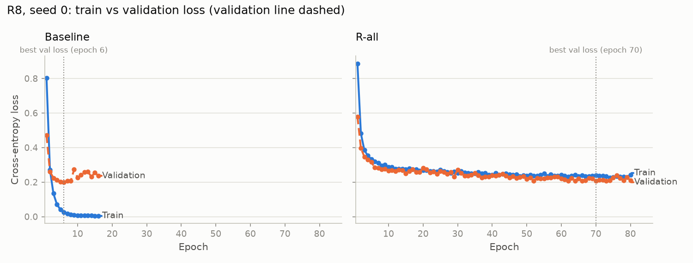
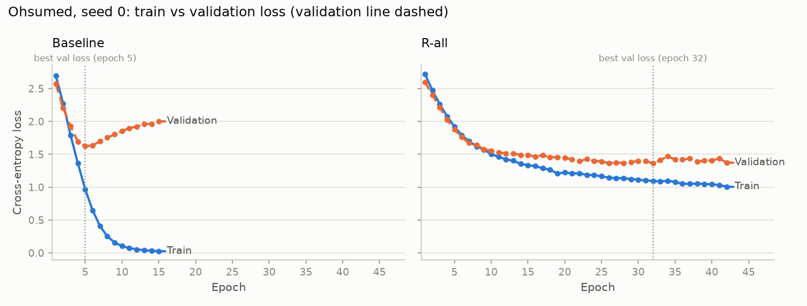

# R-all: four anti-overfitting remedies at once

R-all is `configs/baseline.yaml` with exactly four changes, fixed in advance and not tuned: weight decay 5e-3 (baseline 5e-4), label smoothing 0.1 on the training loss (baseline 0), training helpers redrawn every epoch from each document's top-50 intimacy list with probability proportional to intimacy (baseline: fixed top-23), and frozen input embeddings (baseline: fine-tuned). Validation and test always use the fixed top-23 helpers, and validation loss for early stopping is plain cross-entropy. Same seeds, validation splits and early stopping as the baseline.

Baseline accuracy, macro-F1, best epoch and s / epoch come from `results/baseline/`. Train and validation accuracy at the best epoch come from a replay of the baseline with training-accuracy logging (`results/experiments/R_all/baseline_replay/`), which reproduced the saved baseline exactly: R8 yes, Ohsumed yes.

- **Accuracy and macro-F1:** test set, in %, mean ± sample std (ddof = 1) over seeds 0–4.
- **Train accuracy:** eval mode (dropout off), training documents without the validation split, fixed top-23 helpers, at the best-validation-loss epoch.
- **Δ:** R-all mean minus baseline mean. **p:** two-sided paired t-test across the 5 seeds (df = 4); `*` marks p < 0.05.
- **Paper:** TG-Transformer accuracy reported in the paper; macro-F1 is not reported.

## R8

| Model | Accuracy | Δ acc | p (acc) | Macro-F1 | Δ F1 | p (F1) | Best epoch | Epochs run | Train acc at best | Val acc at best | s / epoch |
|---|---|---|---|---|---|---|---|---|---|---|---|
| **baseline** | 95.08 ± 0.29 | — | — | 86.50 ± 1.76 | — | — | 5.6 | 15.6 | 99.61 ± 0.35 | 94.93 ± 0.54 | 3.65 |
| R-all | 94.96 ± 0.68 | -0.12 | 0.687 | 86.37 ± 3.92 | -0.13 | 0.922 | 36.0 | 46.0 | 96.48 ± 0.63 | 94.64 ± 1.19 | 1.62 |
| paper (TG-Transformer) | 98.1 | | | not reported | | | | | | | |

Per-seed test accuracy (%), seeds 0–4: baseline 95.29 95.11 94.61 95.02 95.34; r_all 95.34 94.02 94.47 95.61 95.34

## Ohsumed

| Model | Accuracy | Δ acc | p (acc) | Macro-F1 | Δ F1 | p (F1) | Best epoch | Epochs run | Train acc at best | Val acc at best | s / epoch |
|---|---|---|---|---|---|---|---|---|---|---|---|
| **baseline** | 53.79 ± 1.18 | — | — | 34.74 ± 2.43 | — | — | 5.6 | 15.6 | 88.88 ± 4.39 | 56.13 ± 2.70 | 2.57 |
| R-all | 61.62 ± 0.37 | +7.83 | 0.000* | 49.09 ± 1.24 | +14.35 | 0.000* | 39.4 | 49.4 | 79.30 ± 2.19 | 61.61 ± 1.46 | 0.98 |
| paper (TG-Transformer) | 70.4 | | | not reported | | | | | | | |

Per-seed test accuracy (%), seeds 0–4: baseline 54.04 53.03 53.55 55.68 52.66; r_all 61.22 61.51 61.44 61.74 62.18

The loss curves show plain cross-entropy for both models. R-all optimises the label-smoothed loss, which cannot fall below the entropy of the smoothed target (0.47 for R8's 8 classes, 0.61 for Ohsumed's 23), so its plain training loss is plotted to keep the panels comparable. Training loss is measured with dropout on, averaged over the epoch.

## Failures

None: R-all and the baseline replay completed for all 2 datasets × 5 seeds.
