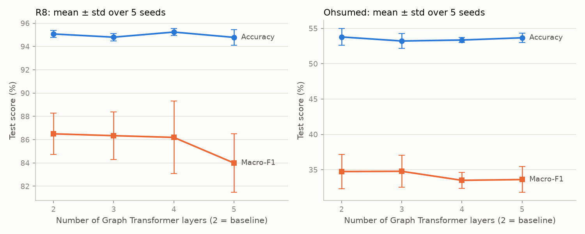
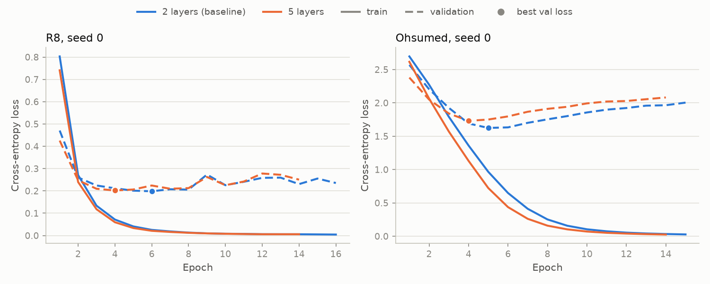

# E6 · Depth: number of Graph Transformer layers

One change relative to `configs/baseline.yaml`: `num_layers` ∈ {3, 4, 5} (baseline 2), via `run.py --num_layers`. Everything else is the baseline: intimacy sampler (α = 0.15, k = 23, cached slices), type + full-graph WL encodings, hidden 32, 4 heads, mean readout, Adam lr 1e-3, weight decay 5e-4 (not on the embedding table), dropout 0.5, batch 64, ≤ 200 epochs, early stopping patience 10 on validation loss, fine-tuned embeddings. Seeds 0–4 with the same validation splits as the baseline. Each layer has its own attention / FFN weights; the G-Res projection of the raw features is shared and added after every layer; readout and classifier are unchanged.

Baseline accuracy and macro-F1 come from `results/baseline/`. Depth 2 was re-run with the E6 code (`results/experiments/e6/depth2/`) for train accuracy and over-smoothing; it reproduced the saved baseline exactly: R8 yes, Ohsumed yes.

- **Accuracy and macro-F1:** test set, in %, mean ± sample std (ddof = 1) over seeds 0–4.
- **(Δ):** depth mean minus baseline mean; `*` marks p < 0.05 in a two-sided paired t-test across the 5 seeds (df = 4). No multiple-comparison correction.

## Results

| Setting | R8 accuracy | R8 macro-F1 | Ohsumed accuracy | Ohsumed macro-F1 |
|---|---|---|---|---|
| **baseline (2 layers)** | 95.08 ± 0.29 | 86.50 ± 1.76 | 53.79 ± 1.18 | 34.74 ± 2.43 |
| 3 layers | 94.80 ± 0.32 (-0.27) | 86.34 ± 2.05 (-0.16) | 53.22 ± 1.04 (-0.57) | 34.77 ± 2.27 (+0.03) |
| 4 layers | 95.24 ± 0.30 (+0.16) | 86.19 ± 3.11 (-0.31) | 53.36 ± 0.37 (-0.44) | 33.50 ± 1.13 (-1.24) |
| 5 layers | 94.78 ± 0.68 (-0.29) | 83.99 ± 2.52 (-2.51) | 53.67 ± 0.65 (-0.12) | 33.61 ± 1.82 (-1.13) |

p-values (accuracy / macro-F1): R8 3 layers 0.074 / 0.922; R8 4 layers 0.326 / 0.867; R8 5 layers 0.347 / 0.190; Ohsumed 3 layers 0.490 / 0.982; Ohsumed 4 layers 0.504 / 0.227; Ohsumed 5 layers 0.854 / 0.184

## Cost, fit and over-smoothing

- **Params:** trainable parameters, total / without the node-embedding table (the table is the same at every depth).
- **s / epoch:** mean wall time of one epoch (training + validation), mean over seeds; CPU, runs executed one after another.
- **Train acc at best:** eval mode (dropout off), training documents without the validation split, at the best-validation-loss epoch; mean ± std over seeds.
- **Cos sim:** mean pairwise cosine similarity between the real nodes of a test slice (24 nodes, 276 pairs), averaged over all test slices, seed 0, best checkpoint. *Output* = after the last layer including G-Res (what the readout averages); *pre-G-Res* = last encoder layer before the G-Res term is added; *input* = projected H(0) before layer 1. 1.0 would mean all node vectors point the same way.

### R8

| Depth | Params (total / no emb) | s / epoch | Best epoch | Epochs run | Train acc at best | Cos sim output | Cos sim pre-G-Res | Cos sim input |
|---|---|---|---|---|---|---|---|---|
| 2 | 4,642,020 / 33,120 | 3.41 | 5.6 | 15.6 | 99.61 ± 0.35 | 0.662 | 0.786 | 0.273 |
| 3 | 4,648,484 / 39,584 | 3.90 | 6.8 | 16.8 | 99.51 ± 0.61 | 0.699 | 0.821 | 0.332 |
| 4 | 4,654,948 / 46,048 | 4.50 | 5.0 | 15.0 | 99.41 ± 0.58 | 0.727 | 0.840 | 0.357 |
| 5 | 4,661,412 / 52,512 | 5.06 | 3.8 | 13.8 | 99.26 ± 0.37 | 0.733 | 0.841 | 0.418 |

### Ohsumed

| Depth | Params (total / no emb) | s / epoch | Best epoch | Epochs run | Train acc at best | Cos sim output | Cos sim pre-G-Res | Cos sim input |
|---|---|---|---|---|---|---|---|---|
| 2 | 6,501,015 / 33,615 | 2.48 | 5.6 | 15.6 | 88.88 ± 4.39 | 0.454 | 0.569 | 0.195 |
| 3 | 6,507,479 / 40,079 | 2.90 | 5.2 | 15.2 | 89.81 ± 3.25 | 0.480 | 0.600 | 0.220 |
| 4 | 6,513,943 / 46,543 | 3.13 | 4.6 | 14.6 | 87.62 ± 5.26 | 0.546 | 0.668 | 0.264 |
| 5 | 6,520,407 / 53,007 | 3.70 | 4.6 | 14.6 | 88.66 ± 4.91 | 0.578 | 0.692 | 0.224 |

Per-seed test accuracy (%), seeds 0–4: R8 2 layers: 95.29 95.11 94.61 95.02 95.34; R8 3 layers: 95.25 94.79 94.38 94.93 94.66; R8 4 layers: 95.71 95.20 95.20 94.88 95.20; R8 5 layers: 95.48 95.48 94.11 94.70 94.15; Ohsumed 2 layers: 54.04 53.03 53.55 55.68 52.66; Ohsumed 3 layers: 54.98 53.20 52.86 52.26 52.78; Ohsumed 4 layers: 53.01 53.50 52.98 53.45 53.85; Ohsumed 5 layers: 52.56 54.09 53.65 54.12 53.95

Training loss is measured with dropout on and averaged over the epoch; validation loss with dropout off.

## Summary

- **Depth does nothing measurable.** Across 3, 4 and 5 layers every accuracy change is within ±0.6 points and no difference is significant (all p ≥ 0.07, accuracy and macro-F1, both datasets). The largest drop is R8 macro-F1 at 5 layers (−2.5, p = 0.19), driven by two seeds; it comes with a doubled seed spread (accuracy std 0.29 → 0.68).
- **Fit and overfitting are unchanged.** Training accuracy at the best epoch stays at 99.3–99.6% on R8 and 87.6–89.8% on Ohsumed. Deeper models reach their best validation loss as early or earlier (R8 best epoch 5.6 → 3.8 at 5 layers; Ohsumed 5.6 → 4.6) and fit the training set slightly faster (seed-0 curves), so the extra capacity only speeds up overfitting.
- **Mild, gradual smoothing, no collapse.** Mean pairwise cosine similarity of the output node vectors rises with depth (R8 0.66 → 0.73, Ohsumed 0.45 → 0.58 from 2 to 5 layers) and, inside the 5-layer models, rises layer by layer (per_seed.csv). It stays far from 1; before the G-Res term it is ~0.12 higher, so G-Res keeps the nodes apart. The smoothing does not show up as an accuracy loss.
- **Cost:** each extra layer adds 6,464 parameters (+20% of the 33k non-embedding parameters; negligible next to the 4.6–6.5 M embedding table) and ~0.5 s / epoch; 5 layers is ~1.5× the baseline time per epoch (R8 3.41 → 5.06 s, Ohsumed 2.48 → 3.70 s) for no gain. Two layers remains the right choice.

## Failures

None: all 4 depths completed for 2 datasets × 5 seeds.
