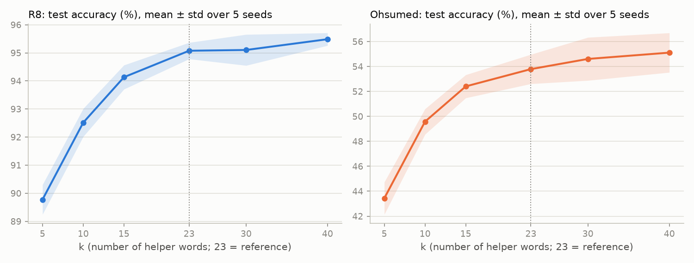
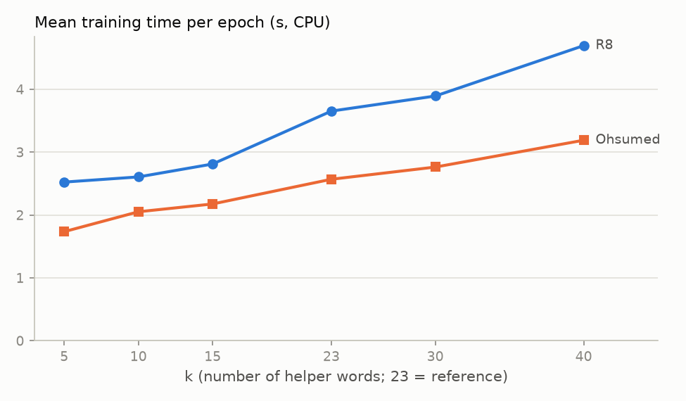

# Experiments E1–E5

**Reference configuration: `configs/baseline.yaml`** (`configs/baseline_v2.yaml` does not exist; the optional tuning step was not run). Reference results are reused from `results/baseline/`, not re-run: k = 23, intimacy sampler, type and WL encodings on, mean readout, fine-tuned embeddings.

Every setting changes exactly one thing relative to the reference.

- **Runs:** datasets R8 and Ohsumed; seeds 0–4.
- **Validation split:** identical across settings for each seed (it depends only on the seed).
- **Accuracy and macro-F1:** in %, mean ± sample std (ddof = 1) over the 5 seeds.
- **Δ:** setting mean minus reference mean.
- **p-values:** two-sided paired t-test across the 5 seeds (df = 4); `*` marks p < 0.05. No correction for multiple comparisons was applied (24 setting × dataset tests per metric).

## R8

| Experiment | Setting | Accuracy | Δ acc | p (acc) | Macro-F1 | Δ F1 | p (F1) | Best epoch | s / epoch |
|---|---|---|---|---|---|---|---|---|---|
| — | **reference** | 95.08 ± 0.29 | — | — | 86.50 ± 1.76 | — | — | 5.6 | 3.65 |
| E1 | type off, WL off | 94.97 ± 0.42 | -0.11 | 0.479 | 83.82 ± 2.13 | -2.68 | 0.007* | 3.6 | 3.19 |
| E1 | type on, WL off | 94.98 ± 0.41 | -0.09 | 0.483 | 86.15 ± 0.89 | -0.35 | 0.671 | 5.4 | 3.32 |
| E1 | type off, WL on | 94.99 ± 0.35 | -0.08 | 0.152 | 85.60 ± 3.11 | -0.90 | 0.499 | 5.4 | 3.22 |
| E2 | sampler = tfidf | 95.73 ± 0.31 | +0.66 | 0.012* | 88.28 ± 1.34 | +1.78 | 0.170 | 10.8 | 3.28 |
| E2 | sampler = random | 85.59 ± 1.41 | -9.48 | 0.000* | 51.41 ± 5.43 | -35.09 | 0.000* | 8.6 | 3.22 |
| E3 | k = 5 | 89.78 ± 0.53 | -5.30 | 0.000* | 78.42 ± 1.27 | -8.08 | 0.001* | 4.2 | 2.52 |
| E3 | k = 10 | 92.52 ± 0.50 | -2.56 | 0.001* | 83.40 ± 1.85 | -3.10 | 0.011* | 5.6 | 2.61 |
| E3 | k = 15 | 94.13 ± 0.43 | -0.94 | 0.017* | 85.62 ± 0.97 | -0.88 | 0.393 | 6.4 | 2.81 |
| E3 | k = 30 | 95.10 ± 0.55 | +0.03 | 0.879 | 86.55 ± 1.43 | +0.05 | 0.871 | 11.0 | 3.89 |
| E3 | k = 40 | 95.49 ± 0.22 | +0.41 | 0.015* | 87.13 ± 1.73 | +0.63 | 0.673 | 6.8 | 4.69 |
| E4 | readout = target | 95.69 ± 0.36 | +0.61 | 0.077 | 87.86 ± 2.01 | +1.36 | 0.364 | 11.0 | 3.35 |
| E5 | freeze_embeddings = on | 95.05 ± 0.32 | -0.03 | 0.756 | 87.73 ± 1.25 | +1.23 | 0.138 | 8.8 | 1.50 |

## Ohsumed

| Experiment | Setting | Accuracy | Δ acc | p (acc) | Macro-F1 | Δ F1 | p (F1) | Best epoch | s / epoch |
|---|---|---|---|---|---|---|---|---|---|
| — | **reference** | 53.79 ± 1.18 | — | — | 34.74 ± 2.43 | — | — | 5.6 | 2.57 |
| E1 | type off, WL off | 48.23 ± 1.60 | -5.56 | 0.011* | 26.52 ± 3.15 | -8.22 | 0.026* | 4.0 | 2.32 |
| E1 | type on, WL off | 50.13 ± 2.43 | -3.66 | 0.016* | 28.19 ± 2.84 | -6.55 | 0.001* | 4.0 | 2.42 |
| E1 | type off, WL on | 53.12 ± 1.28 | -0.67 | 0.525 | 33.49 ± 3.80 | -1.25 | 0.618 | 5.8 | 2.36 |
| E2 | sampler = tfidf | 54.98 ± 1.02 | +1.19 | 0.002* | 35.48 ± 2.25 | +0.74 | 0.114 | 5.6 | 2.38 |
| E2 | sampler = random | 14.66 ± 0.18 | -39.13 | 0.000* | 1.29 ± 0.39 | -33.46 | 0.000* | 2.4 | 2.54 |
| E3 | k = 5 | 43.44 ± 1.29 | -10.35 | 0.000* | 28.36 ± 3.83 | -6.38 | 0.051 | 5.2 | 1.74 |
| E3 | k = 10 | 49.58 ± 1.02 | -4.21 | 0.001* | 34.12 ± 2.44 | -0.62 | 0.684 | 6.0 | 2.05 |
| E3 | k = 15 | 52.41 ± 0.93 | -1.39 | 0.040* | 35.59 ± 3.05 | +0.84 | 0.418 | 5.8 | 2.18 |
| E3 | k = 30 | 54.61 ± 1.73 | +0.82 | 0.083 | 34.74 ± 2.85 | -0.00 | 0.995 | 5.6 | 2.76 |
| E3 | k = 40 | 55.11 ± 1.58 | +1.32 | 0.010* | 33.66 ± 2.77 | -1.08 | 0.078 | 5.4 | 3.19 |
| E4 | readout = target | 45.47 ± 2.29 | -8.33 | 0.001* | 26.77 ± 2.75 | -7.97 | 0.000* | 7.2 | 2.43 |
| E5 | freeze_embeddings = on | 58.36 ± 1.25 | +4.57 | 0.006* | 42.17 ± 3.02 | +7.43 | 0.006* | 10.8 | 0.93 |

## E3: accuracy and time per epoch vs k

The k = 23 point is the reference run from `results/baseline/`. The other k values ran one after another in a single batch on the same CPU, so their times per epoch are directly comparable. The k = 23 timing comes from the earlier baseline run, so it may differ slightly because of machine load.

## E2: preprocessing time per sampler (k = 23, seconds)

| Dataset | Sampler | Components | Total (s) |
|---|---|---|---|
| R8 | intimacy | graph_build 1.808, S_compute 29.318, helper_selection 1.955, slice_build 0.000 | 33.08 |
| R8 | tfidf | tfidf_matrix 0.049, slice_build 0.038 | 0.09 |
| R8 | random | slice_build 0.700 | 0.70 |
| Ohsumed | intimacy | graph_build 5.421, S_compute 80.025, helper_selection 2.807, slice_build 0.000 | 88.25 |
| Ohsumed | tfidf | tfidf_matrix 0.109, slice_build 0.044 | 0.15 |
| Ohsumed | random | slice_build 1.223 | 1.22 |

Intimacy times for the graph build, S and helper selection come from the preprocessing run (`results/preprocessing_<dataset>.json`). Everything else was measured by `time_samplers.py` (median of 3 repetitions). The WL encoding needs the graph whichever sampler is used, so the graph-build cost is avoided only if WL is also off.

## Failures

None: all 12 settings × 2 datasets × 5 seeds completed.
